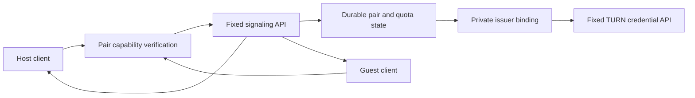

# Authenticated signaling and temporary credential delivery

Status: closed-pair source; a closed pilot Worker is deployed and has run pilots 002 and 004; no menu-to-relay pilot has passed yet
Last updated: 2026-11-07 (a link to a runner script that is not in the tree is removed); earlier: 2026-11-03
Summary: fixed two-player routes, signed accountless pair admission, a private issuer binding and the HTTPS/client contract compose with durable permits and encrypted storage in authored offline checks.

## Decision and existing boundary

The first experimental service admits one private, operator-approved pair
through separate short-lived host and guest capabilities. Players do not need
registered accounts. A fixed HTTPS API and the existing durable pair/permit
authority remain the boundary. Cloudflare Access/OAuth is an optional future
identity route, not a prerequisite for this pair flow. A closed pilot Worker is
deployed: the r2 bundle, built from the
[closed_signaling sources](../services/closed_signaling/README.md) on main,
admitting 24 pair approvals and 96 issuance permits per UTC day. It has run
pilots 002 and 004, but no menu-to-relay pilot has passed yet. The existing TURN
product is separate from selecting a broker host, paid Workers plan or identity
provider; this source performs no account, subscription or deployment operation.

The current game-side implementation is [the local courier](ICE-PILOT-COURIER.md),
[private operator issuance](RELAY-ACCESS.md), `CeIceExchange`, and the pending
game-session adapter. It does not move setup files between machines by itself.
The existing `relay_access_policy.py` experiment accepts a trusted-verifier
output and models a two-member session, invitations and bounded attempts. It has
no real authentication verifier, durable replay store or hosted adapter. Creating
a `VerifiedPrincipal` object, presenting a join code, or supplying a matching
context does not authenticate an account.

The [offline SQLite store](../tools/signaling_session_store.py) implements the
fixed-route and durable-permit contract below. The accountless binding described
below supplies its verifier and private issuer contracts; checks use authored
keys and fake provider responses. The existing CE schema validators and strict
provider parser are reused. There is no listener or native game connection, and
the older in-memory policy experiment is not a second admission owner.

This proposal replaces the repeated file handoffs, not the existing private CE
join code or the game's authenticated START. Public browsing, anonymous room
creation, public invitation redemption and self-service account enrollment are
later service work. Their omission from this first closed pilot does not change
the broader multiplayer goal.

## Official hosting facts, checked 2026-11-02 UTC

| Component | Published free allowance and consequence |
| --- | --- |
| Workers Free | 100,000 requests per day; 10 ms CPU per invocation. A paid Workers subscription is a separate product decision, not implied by paying for TURN. [Pricing](https://developers.cloudflare.com/workers/platform/pricing/) |
| SQLite Durable Objects on Workers Free | Available on the free plan: 100,000 requests/day, 13,000 GB-s/day, 5 million rows read/day, 100,000 rows written/day and 5 GB stored. Exceeding a free allowance fails that operation; daily allowances reset at 00:00 UTC. [Pricing](https://developers.cloudflare.com/durable-objects/platform/pricing/) |
| Cloudflare One / Access | The published free plan permits up to 50 users. This can cover a closed two-player test; it is not evidence that the current account or chosen identity provider is configured. [Plans](https://www.cloudflare.com/plans/) |
| Endpoint name | Workers accounts include a `workers.dev` name, so a pilot need not buy a domain. Cloudflare recommends a route/custom domain for production and describes `workers.dev` as suitable for personal or hobby use. [Routing](https://developers.cloudflare.com/workers/configuration/routing/workers-dev/) |
| TURN | The documented allowance is 1,000 GB before charges, then $0.05/GB of server-to-client traffic, including overhead. Existing usage can consume that allowance. TURN billing remains distinct from signaling hosting. [TURN FAQ](https://developers.cloudflare.com/realtime/turn/faq/) |

Free-tier facts are dated, not a promise of permanent availability or zero cost.
Use a verified free configuration and fail closed at its limits; never upgrade
or change billing automatically. On a paid account the applicable billing mode
must be checked separately. Workers Free exhaustion can return error 1027;
security-sensitive routing must use fail-closed behavior.
[Workers limits](https://developers.cloudflare.com/workers/platform/limits/)

No R2 bucket, queue, external database, email subscription, custom domain purchase
or third-party analytics service is needed for this design. Accountless pair
admission adds no external identity provider. Any later identity product, host,
paid plan or new data recipient needs its own explicit selection before use.

## Authentication precedes creation of a CE attempt

The experimental verifier authenticates possession of a signed role capability,
not a human identity or a registered account. Obtain the operator-approved pair
and explicit consent before starting the CE session's 120-second timer. The
capability is a separate credential from the CE join code/session secret. A
public room handle, a display name or a body `subject` never authenticates a
member. Fresh random pseudonymous subjects are used for each pair; no email or
external account identifier is required.

The operator approves two distinct subjects and assigns one host and one guest.
Both must explicitly accept the fixed pair. No public endpoint mints a pair or
capability. The two independently submitted CE contexts must match, and the game
continues to perform its own peer authentication and authenticated START.

If an account-based route is later selected, Access Managed OAuth is a candidate
for a native public client: authorization code, PKCE, a system browser, a fixed
resource/issuer and strict redirect/state validation. Do not embed a shared
client secret or service token in the game. That integration remains new work.
[Managed OAuth](https://developers.cloudflare.com/cloudflare-one/access-controls/applications/http-apps/managed-oauth/),
[RFC 8252](https://www.rfc-editor.org/rfc/rfc8252),
[OAuth security BCP](https://www.rfc-editor.org/rfc/rfc9700)

The reviewed Managed OAuth page does not itself establish the selected tenant's
PKCE metadata or behavior. Before adopting that route, verify S256 support and
authorization-code binding against an explicitly approved test configuration.
If it cannot meet the native-client requirements, keep authentication closed
and choose a supported provider; do not downgrade to a shared service secret.

For an optional Access-protected direct API Worker, require `ctx.access`, the configured application
audience, and a real authenticated user identity on every request. Deny missing
identity, service-token identities on player routes, unknown users and wrong
audiences. Use the provider's stable user identifier, scoped to the configured
identity authority; do not authorize a claimed email, body `subject`, forwarded
header or room identifier. Persist a keyed pseudonymous digest rather than an
email address. Cloudflare documents `ctx.access` for authenticated direct Worker
invocations and `user_uuid` in its identity shape.
[Worker Access](https://developers.cloudflare.com/workers/configuration/cloudflare-access/),
[Identity fields](https://developers.cloudflare.com/cloudflare-one/access-controls/applications/http-apps/authorization-cookie/application-token/)

Protect every reachable API route and preview, not merely a preferred hostname.
The code denies absent or invalid capability verification. An Access-based
implementation must also deny a misconfigured Access policy and verify its
token signature, issuer, audience and validity where required; a header alone
is insufficient.
[JWT validation](https://developers.cloudflare.com/cloudflare-one/access-controls/applications/http-apps/authorization-cookie/validating-json/)

## Components and trust



Only the private issuer receives the provider token/key binding. The public
signaling component has no provider key, no generic fetch/proxy operation and no
caller-selected upstream address. Issuer egress is limited in application code
to the reviewed provider credential endpoint and bounded revocation operation;
redirects and alternative hosts are refused. Only temporary, role-bound grants
are returned to the corresponding player. The issuer must preserve the existing
strict response parsing and secret-free diagnostics.

The present binding is a private object called by the same-process store after
its durable reservation; it is not an independently authenticated remote issuer.
If deployment later separates those components, use a private service binding
instead of a public issuer URL and independently verify its durable, single-use
spending permit. Access context is not propagated through bindings. Never trust
a client-provided `VerifiedPrincipal` or serialized `Issuance` object. Disable
issuer public/preview routes and give no equivalent public HTTP issuance entry
point. Keep its provider token in private server configuration, never in a
returned field, client package or log.
[Service bindings](https://developers.cloudflare.com/workers/runtime-apis/bindings/service-bindings/),
[Worker Access limitations](https://developers.cloudflare.com/workers/configuration/cloudflare-access/),
[Secrets](https://developers.cloudflare.com/workers/configuration/secrets/)

Durable Objects supply transactional, strongly consistent storage, but memory
can be lost on eviction or deployment. A provider fetch can interleave with
other requests; an in-memory flag or single-threaded event loop is not an
issuance lock. Commit reservation, quota consumption and attempt identity before
external issuance. Use a transaction and verify the stored generation before
accepting its result.
[Durable storage](https://developers.cloudflare.com/durable-objects/best-practices/access-durable-objects-storage/),
[Concurrency rules](https://developers.cloudflare.com/durable-objects/best-practices/rules-of-durable-objects/)

## Proposed API contract

The following names are in-process prototype routes, not deployed endpoints.
A future HTTP adapter must use HTTPS POST to fixed paths with an
authorization header. Secrets and identifiers never occur in URLs. Responses
use `Cache-Control: no-store`; no cache or diagnostic body retains grant material.
Bound bodies before JSON decoding, reject duplicate/unknown fields, and return
fixed status codes without reflecting input. Only authenticated callers reach
state allocation or record parsing.

| Operation | Allowed input and effect |
| --- | --- |
| `pair/current` | Return only the caller's one operator-approved pair, opaque approval identifier, assigned role, consent state and absolute expiry; no directory or arbitrary pair lookup. |
| `pair/accept` | Consent to that fixed pair once. A changed counterpart or role requires a new operator approval. |
| `stage/request` | `lobby` or `game`, the existing exact request schema and `afterAuthenticatedStart` (`false` for lobby, `true` for game). Identical request retries are idempotent. Bind role to the authenticated member; freeze the first context and deadlines. Both roles must submit the same context before either credential is issued. |
| `stage/poll` | Return fixed progress plus only this role's existing grant and the opponent's immutable encrypted record when available. Permit bounded retries without reissuing credentials or extending time. |
| `stage/record` | One host offer or one guest answer. Preserve its opaque bytes; validate existing envelope bounds, role, lifetime and answer-to-offer attempt binding. No destination address, raw SDP upload or general message stream. |
| `stage/ack` | Acknowledge the exact received record digest. This allows payload removal after both acknowledgements; it does not assert game connectivity. |
| `pair/close` | Either admitted member may end the pair. Stop delivery/issuance immediately and schedule bounded revocation of known credentials. An administrative kill switch can do the same for all pairs. |

`pair/current` accepts an empty object. Every other operation requires the
exact `approval` returned for that member's current approved pair. Resolve
membership before comparing this identifier; never use it for arbitrary pair
lookup. A delayed acceptance for an old pair cannot consent to its replacement.
The identifier grants no authority without the independently verified member.
It stays in the trusted adapter and never enters player-facing text or logs.

Keep the existing payloads unchanged:

- Request, at most 4 KiB: `schema`, `role`, `context`, `requestedAt`,
  `requestExpiresAt`, `grantExpiresAt`.
- Temporary grant, at most 32 KiB: `schema`, `role`, `context`, `issuedAt`,
  `expiresAt`, `iceServers`, with the fixed provider URL policy already used by
  `ice_credentials.h` and the operator parser.
- Offer/answer: the existing `CEICE002` authenticated encrypted record, at most
  4,194 decoded bytes. The service never derives its encryption key or receives
  the CE secret. The receiving `CeIceExchange` remains the authentication owner.

An outer service handle identifies an approved pair; it is not a replacement CE
secret, an account credential or independent admission authority. A client
adapter writes the validated records atomically into its already selected
private directories, with the same no-replacement rules as the courier. Keep
grants in the trusted adapter; UI gets only fixed phase/status, assigned role,
setup time remaining and actual grant expiry.

Lobby and game are distinct contexts. Game requests require both admitted
members to attest completion of the prior lobby stage and then submit the new,
matching context derived by authenticated START. The service cannot inspect
START and must not claim to verify game progression from those attestations.
Exactly one game stage is allowed per approved pair. A failed attempt, retry or
new mission consumes a fresh operator-approved pair and fresh local directories
under the current caller contract; there is no endpoint that silently resets a
failed stage or substitutes an old answer.

## Bounds, time and recovery

Proposed initial deployment limits are deliberately small: one active pair and
at most four issuance attempts per pair (host/guest times lobby/game), hence
four global issuance permits per approval. The approvals per UTC day are a
configuration ceiling for a closed pilot, not a public-service capacity claim,
and the two implementations carry different ones:

- the offline prototype ([`signaling_session_store.py`](../tools/signaling_session_store.py))
  keeps its original, deliberately small ceiling: two pair approvals, hence eight
  global issuance permits, per UTC day;
- the closed-pair Worker ([`worker.mjs`](../services/closed_signaling/worker.mjs),
  `MAX_APPROVALS_PER_DAY` and `MAX_PERMITS_PER_DAY`) admits 24 approvals and 96
  reserved issuance permits per UTC day, still one active pair at a time.

Reserve all four permits in a global durable budget before accepting a pair. An
approval whose pair is not created leaves no reservation behind: the prototype
reserves and creates the pair in one transaction, and the Worker's activation
failure is described in [its README](../services/closed_signaling/README.md#durable-authority).
Per-stage issuance consumes the specific reserved permit once.

Each role/stage has a durable state machine:

`UNISSUED → RESERVED → ISSUED` or `UNKNOWN/FAILED`, then `CLOSED/EXPIRED`.

`RESERVED` is committed before contacting the provider. Repeated identical calls
return the stored result or pending/terminal state; different payloads under an
existing identifier refuse. If a provider call times out or the process dies
after spending the permit, recovery must not mint again. A response that arrived
before a crash can be redelivered only if the validated grant was durably saved.
An unknown outcome stays burned until expiry or an explicit new approval.
Schema migration and rollback must preserve these consumed permits.

The original **120-second total setup deadline** covers grant waiting, signaling
and ICE readiness. Freeze the minimum of both request deadlines and a server
first-seen deadline. Polling, authentication refresh, a late provider reply and
retries cannot extend it. Each role's local monotonic deadline may expire earlier
and remains authoritative. The 300-second exchange ceiling is independent.

The matched issuer and consumer policy selects 7,200 seconds by default with a
14,400-second ceiling. This prototype reads those issuer constants directly;
the older courier base still needs the matched issuer composition before use.
The service must honor the stricter request `grantExpiresAt`,
pair expiry and chosen stage lifetime. Prefer a short lobby grant, and issue
the game grant only for the approved mission window. Never accept a client TTL
that enlarges server policy or an existing request. Show the actual issued
expiry because setup consumes part of that window.

There is no current TURN renewal or ICE restart implementation. Authentication
token refresh is a separate operation and must not issue another TURN grant.
Expiry ends the current CE session; a mission that may outlast its authorized
grant cannot be promised uninterrupted play. Cloudflare documents a 48-hour
provider ceiling, disconnection shortly after credential expiry and recommends
ICE restart for disruptions. Its browser `RTCPeerConnection` refresh guidance
does not implement refresh in CE/libjuice.
[TURN FAQ](https://developers.cloudflare.com/realtime/turn/faq/),
[Credential lifecycle](https://developers.cloudflare.com/realtime/turn/generate-credentials/)

Use at most one poll per role per second during setup, bounded by the original
deadline. Persist security counters, permits and terminal states. Coarse edge
rate limiting is only an additional filter: Cloudflare documents approximate,
eventually consistent rate limits and recommends Durable Objects for strict
global limits. State-store failure denies issuance; it never falls back to an
in-memory counter or an anonymous path.
[Rate limiting](https://developers.cloudflare.com/workers/runtime-apis/bindings/rate-limit/)

## Spend and arbitrary-relay limits

The signaling API carries only the fixed small records for its two admitted
members. It never forwards gameplay, arbitrary URLs, user-selected upstream
requests or unrestricted message streams. That does **not** make a returned
TURN credential cryptographically specific to one CE peer. The role/context
wrapper is enforced by CE, not by the TURN server; a copied credential can be
used outside CE. The reviewed provider documentation does not establish a
per-credential byte ceiling or a two-peer destination allowlist. Therefore this
design does not establish a hard dollar cap or elimination of credential misuse.

The provider explicitly discusses end-user credential abuse and supports usage
attribution and monitoring. TTL, issuance quotas, closed membership, revocation
and a kill switch reduce exposure. They do not turn delayed analytics into a
synchronous spending limit. Do not adopt an older example's TTL without checking
the current provider and application caps.
[Credential abuse guidance](https://developers.cloudflare.com/realtime/turn/replacing-existing/),
[Analytics](https://developers.cloudflare.com/realtime/turn/analytics/)

An approved operator can monitor aggregate TURN egress using separately scoped
analytics permissions, stop new issuance at a chosen threshold and revoke known
credentials. Cloudflare documents credential revocation, but its latency and
effect on an in-use CE allocation still require a controlled test. If a hard
byte/dollar ceiling or provider-enforced destination restriction is mandatory,
obtain a supported provider control before opening this service; do not claim
that these application counters supply it.
[Revocation](https://developers.cloudflare.com/realtime/turn/generate-credentials/)

## Privacy, transport and UI

The new service would process authenticated identity, pair membership, opaque
contexts, timing, temporary credentials and encrypted connection descriptions.
Cloudflare also processes connection metadata; an identity provider would do
so only if that optional route is selected. This is
a new documented data flow requiring consent and an owner; it is not telemetry
authorization. Do not collect gameplay, saves, retail files, chat or diagnostics.
Keep application logs to aggregate counters and fixed failure categories, with
no token, authorization header, provider username/password, join code, context,
record bytes, email address, IP address or raw exception. Platform-managed
identity/access logs have separate retention and cannot be described as absent.

Delete encrypted signaling payloads after both acknowledgements or their
shorter deadline; retain temporary grant payload only while setup redelivery is
needed, with encryption at rest under a distinct managed secret. Keep the
minimum credential identifier needed for revocation until expiry. Keep a bounded
spent-permit/tombstone record through the maximum authorized lifetime plus a
clock margin, then remove it; retain daily aggregate counters only for their
rate-limit window. Cleanup alarms are best effort, so every read also enforces
expiry. Document deletion and provider retention separately.

Native authentication capabilities stay in owned private memory for the first
pilot. The explicit temporary operator export described below is a separate
private handoff, not persistent login or ordinary configuration. A later login
store needs reviewed OS credential storage. No capability or grant enters argv,
environment variables, clipboard, ordinary stdin/stdout, crash reports or game
UI. The provider master token never leaves the private issuer. The native boot
handoff must carry owned authority, not bearer bytes in an ordinary handoff file.

UI may show `authentication_required`, `awaiting_pair_consent`,
`awaiting_peer_request`, `issuing`, `exchanging`, `service_delivery_complete`,
`setup_expired`, `not_admitted`, `rate_limited`, `issuance_unknown`,
`grant_expired`, `invalid_request`, `unavailable` or `closed`.
Service delivery never means CE is connected.
Only the existing CE/lobby ready outcome enables the lobby/start controls.
Before hosting, explain the bounded pilot lifetime and lack of automatic
reconnection. Sign-in and pairing occur before CE creates its short-lived
request. Refresh and reconnect controls must stay absent until implemented.

The pinned libjuice commit supports UDP only. Accepting a provider response
containing TCP/TLS URLs does not make those transports usable by this client.
UDP-blocked networks have no demonstrated fallback. TURN itself is not an
application-encryption guarantee; preserve and test CE's authenticated transport
and encrypted exchange instead of borrowing WebRTC/DTLS claims.
[Pinned libjuice README](https://github.com/paullouisageneau/libjuice/blob/b89c792e3612faf2f12cf35bcc56857313a06be3/README.md),
[TURN encryption distinction](https://developers.cloudflare.com/realtime/turn/faq/)

## Offline implementation and evidence

`SessionStore` owns one private Linux SQLite directory. `approve_pair` is a
trusted offline operator seam with no public route. `dispatch` accepts only the
fixed names above and an opaque token passed to the injected verifier; request
bodies cannot create a `Principal`. The original store fixture injected an
invented verifier; the accountless binding below now supplies the signed
capability verifier on the same seam. Subject keys
are keyed digests, and grant/record/approval fields are excluded from reply
representations. Callers must still keep those fields out of their own logs.

The SQLite transaction reserves the global four-permit budget and creates the
pair together. Each role/stage permit is committed as reserved before the fake
issuer runs outside the transaction. A ten-second result lease is bounded by
the original setup deadline. The result must match the stored attempt and an
open pair. Restart, concurrent polling, timeout, close and an uncertain result
never return the permit to available. Valid late results are withheld; only
their bounded revocation identifiers remain for a future revocation adapter.
There is no actual revocation call or automatic retry.

The store persists the prototype's two-approval/eight-permit UTC-day budget (the
Worker's is 24 and 96, set in its own code), at most one active pair, one poll
per role per second and 1,024 member calls per pair.
Malformed authenticated member bodies consume the call allowance; closing a
pair remains possible after that allowance is spent. Unknown callers cannot
allocate a pair or issue a grant. Hosted ingress denial-of-service controls,
provider byte limits and a hard spending cap are not implemented by these
local counters. UTC moving backward refuses work rather than reopening a
deadline. Reopening with changed binding-key or lifetime policy also refuses.
The daily budget counts permits reserved on the approval day; unused permits
can be consumed after midnight within the pair lifetime. The result lease
limits acceptance of a callback result; it does not cancel a stalled callback.

The focused suite exercises two SQLite connections racing one permit,
interruption after reservation and after a fake provider reply, saved-result
redelivery after reopening, consent replacement, deadline shrink/no extension,
pair and request lifetime bounds, quota persistence, provider refusal and
private file modes. Removing the reservation causes a second fake issuance;
removing membership, approval, deadline or offer-attempt checks fails the
corresponding controls. Pinned `CeIceExchange` processes consume the delivered
offer and answer; missing delivery remains pending and changed ciphertext is
rejected. Those are exchange/transport-contract checks, not game admission.

## Authenticated encryption of local parcels

The [parcel binding](../tools/signaling_parcel_crypto.py) calls the already
pinned Monocypher 4.0.2 `crypto_aead_lock` and `crypto_aead_unlock` functions.
These provide XChaCha20-Poly1305 authenticated encryption; this component does
not implement a cipher or MAC. Each encryption uses a fresh 24-byte OS random
nonce. No SQLite nonce counter can roll back with an interrupted transaction.
Nonce sampling tests exercise writes and restarts; they do not prove impossible
random collisions. The format also carries a version marker and authentication
tag. Parcel and associated-data sizes are bounded before native calls.
[Monocypher AEAD documentation](https://monocypher.org/manual/aead)

The store requires an explicitly supplied, separate 32-byte synthetic storage
key through `ParcelCipher`. Reusing the identity-binding key is refused. The
fixture compiles the exact pinned source archive locally and verifies the
library bytes before loading; no dependency is downloaded at runtime. This
local library receipt is not a deployed code-signing or cloud-key mechanism.
The existing archive URL, SHA-256 and `BSD-2-Clause OR CC0-1.0` licence remain
the [courier fixture pins](../tools/ice_pilot_courier_tests.py).

Request payloads, temporary grants, opaque offer/answer records and revocation
identifiers are encrypted before SQLite receives their values. Associated
data binds the format, random store identifier, pair, stage, role and purpose,
plus applicable context, attempt, expiry and record digest. Changed ciphertext,
tags, nonces, protected metadata or parcels moved to another role refuse
delivery. Such a refusal does not refund a consumed issuance permit. The
existing reservation commits before the fake issuer; encryption and the saved
result commit afterward in one transaction.

Routing metadata and counters remain ordinary SQLite fields inside the
private directory. This is parcel confidentiality and authenticity, not
whole-database authentication or rollback protection. An attacker able to
replace the entire database or alter its authorization state is outside this
local storage claim. Real key custody, rotation, backup protection and
deployed access controls remain unimplemented.

Only new version-2 databases are initialized. Existing plaintext databases are
refused by a read-only preflight rather than converted in place, since old WAL
and free pages could still contain plaintext. This is not authority to reset
live quota/permit state; a future deployed migration must preserve those
records under a separately reviewed procedure. Historical fixture databases
remain unchanged.

The tests scan database, WAL and shared-memory files for synthetic credential,
record and storage-key markers before and after logical removal, with SQLite
secure deletion disabled. They check upstream known-answer vectors, tampering,
row swaps, wrong keys, nonce samples and abrupt process exits at reservation,
provider-response and encrypted-commit boundaries. Removing encryption makes
the raw-storage check fail; weakened nonce, tag and binding checks fail their
controls. Ciphertext may still remain in journals and free pages after expiry.
That ciphertext is not securely erased, and a retained storage key can decrypt
retained ciphertext. Python may also retain in-memory plaintext copies. No
cryptographic-deletion or complete memory-erasure claim is made.

Run the offline cases from a Linux checkout with the pinned local archive:

```sh
python3 port/tools/signaling_session_store_tests.py --output local-data/signaling-check \
  --monocypher-archive ARCHIVE
```

Use a new output directory. The optional real encrypted-exchange check adds
`--exchange-source PATH`; its exact source hashes,
archive URL, licence and SHA-256 are the existing
[courier fixture pins](../tools/ice_pilot_courier_tests.py). Without the exchange
source, that optional check is explicitly skipped; the archive is always
required for encrypted storage. Verification used a network-disabled
namespace, private HOME/TMPDIR, no desktop/session environment, disabled core
dumps and bounded CPU/memory. No libjuice agent, provider connection or game
process is created by this suite.

This is Linux SQLite behavior, not a Cloudflare Durable Objects integration or
a Windows privacy result. It does not establish OAuth/Access verification,
a remote private service binding, provider calls, deployed secret bindings,
background cleanup alarms, native game integration or deployment configuration.
The local API and accountless composition below have their own authored checks.
The local transaction does
not prove cross-object reservation/burn behavior on Cloudflare. The native
Monocypher binding has not been integrated with that runtime or its key store.
Those privacy and durability requirements remain deployment work. The game-stage flag is member
attestation, and `service_delivery_complete` still does not mean CE is ready.

## Separate native Worker parcel format

The [Worker parcel binding](../services/closed_signaling/parcel_crypto.mjs)
uses workerd's native Web Crypto AES-256-GCM implementation. It does not load
Python, `ctypes`, a shared library or WebAssembly. Cloudflare documents AES-GCM,
key import and cryptographically generated random values in that runtime; the
Web Crypto specification defines authenticated additional data and combined
ciphertext/tag output.
[Workers Web Crypto](https://developers.cloudflare.com/workers/runtime-apis/web-crypto/),
[Web Crypto AES-GCM](https://www.w3.org/TR/2017/REC-WebCryptoAPI-20170126/#aes-gcm)

This is a separate `CEWGCM01` envelope: a version marker, a fresh 96-bit random
nonce, ciphertext and a 128-bit authentication tag. A fixed ordered encoding
binds the format, algorithm, key identity, store, pair, stage, role, purpose,
context, attempt, expiry and digest. Plaintext is limited to 32 KiB; metadata is
bounded before the native call. Wrong keys, altered protected metadata and
unrecognized formats refuse. The older Python `CESPAR02` format and SQLite
version-2 store remain unchanged; there is no implicit conversion or fallback.

Metadata values match the existing store's `_associated` calls directly:
`store` and `pair` are 32 lowercase hexadecimal characters, and `context` is
64. The existing `expires` value is named `expiresAt` in this binding; no other
identifier or value is transformed. The fixed array authenticates all fields,
including empty strings and zero. It also authenticates the new format,
algorithm and key domain, so this is not ciphertext compatibility with
`CESPAR02`.

| Purpose | Attempt | Digest | Expiry |
| --- | --- | --- | --- |
| Request | Empty string | Empty string | Zero, as in the existing request AAD; the store separately enforces its setup deadline |
| Grant or revocation identifier | 32 lowercase hexadecimal characters | Empty string | Positive integer timestamp |
| Offer/answer record | Empty string | 64 lowercase hexadecimal characters | Positive integer timestamp |

The authored cases cover each valid purpose, reject the former all-64-character
identifier assumption, and change between valid purpose bindings when testing
authentication failure. No padding, truncation or implicit digest substitutes
for an existing metadata value.

Key import requires an explicit 32-byte value and creates a non-extractable
`CryptoKey`. That protects against accidental export through this API; it is
not managed key custody, protection against authorized Worker code, memory
erasure or a claim that binding values disappear from the platform. A future
store owner must use a dedicated key, reserve a durable per-key encryption
budget before every encryption, and refuse when that budget or its key
configuration is absent. It must not reuse a key across independently reset
journals. Random nonces do not establish whole-database rollback protection.

The offline runtime fixture ([`crypto_tests.mjs`](../services/closed_signaling/crypto_tests.mjs); its original runner script is not in this tree) uses the exact
[runtime and vector pins](../services/closed_signaling/runtime.pin.json).
It runs authored handlers through workerd's built-in `test` command, with no
socket configuration, an explicit denied outbound service, and a separate
network-disabled namespace. Disk-backed SQL Durable Objects exercise stored
ciphertext and process reopen. The fixture has no successful HTTP route and
uses only invented key/credential markers and public algorithm vectors.
The workerd `localDisk` setting is experimental; local disk results do not
establish Cloudflare replication, eviction, deployment or power-loss behavior.
[Pinned runtime configuration](https://github.com/cloudflare/workerd/blob/c4ae7efa554a0483044c2c540ee64f87093501b9/src/workerd/server/workerd.capnp),
[Durable Object storage API](https://developers.cloudflare.com/durable-objects/api/sqlite-storage-api/)

Prepare the pinned inputs under an ignored directory: the runtime package at
`runtime/package/bin/workerd`, its matching `LICENSE.workerd.txt`, the pinned
`aes_256_gcm_tests.txt` and its complete `LICENSE.boringssl.txt`. A runner verifies their hashes and
never downloads a dependency; use a fresh output directory and the normal resource/quiet-window
coordination. The runner that ran this fixture is not in this tree, and the one that is,
`port/tools/signaling_worker_http_tests.py` (see the service [README](../services/closed_signaling/README.md)), runs the HTTP routes, not this fixture.

The runtime and public test vectors retain their pinned Apache-2.0 licences
and upstream notices. They are test inputs, not bundled CE runtime files.
The authored binding, fixture and runner remain GPL-3.0-only. No dependency
binary, third-party source or test-vector payload is committed by this step.

The new Worker cases have not yet run; this is source pending runtime
validation. The binding uses native APIs to avoid the shared-library
portability obstacle. It does not
implement the authenticated entry routes, pair consent, durable global cost
authority, issuer/revocation binding, managed keys or game-side transport.
Those components must remain closed until connected and tested together. In
particular, a native crypto round trip does not establish the irreversible
issuance-permit behavior already required by the Python store.

## Accountless experimental pair binding

[`signaling_pair_bindings.py`](../tools/signaling_pair_bindings.py) implements
the existing verifier and issuer seams without adding another store. Its
`PairCapabilityVerifier` checks a versioned HMAC-SHA256 capability before
creating a `Principal`. A dedicated server admission key signs a canonical
payload containing only schema, audience, fresh pseudonymous subject, role and
absolute issued/expiry times. The key is separate from the provider master key,
the store's identity/parcel keys and the CE join secret. No key is loaded by
this module, and there is no public signing or pair-mint route.

The capability authenticates possession, not a person's name or a registered
account. Its role must match its subject namespace, and its audience is fixed
to this service. The existing store independently resolves actual membership
and role, requires explicit consent, and enforces the approval and stage
context. A correctly signed subject outside the approved pair remains denied.
The capability contains no CE context, join secret, TURN credential or provider
key. Knowing a public room handle cannot create one. A private capability may
be delivered as the experimental participant invitation; whoever possesses it
can act as that role until the pair is closed or expires.

`prepare_pair(store, verifier, clock)` is a trusted operator call. It first
commits `approve_pair` and the existing four-permit/global-budget reservation,
then signs separate host/guest capabilities. It round-trips each through the
configured verifier and actual store to confirm role, approval and expiry.
It never issues TURN credentials. A failure after approval leaves the existing
reservation spent, and there is no automatic approval/signing retry. Retain the
returned private bundle for identical export retries; do not reset the database
or regenerate a pair as lost-response recovery. Its default lifetime is the
existing 7,200-second policy and cannot exceed the configured bounded maximum.

`export_role(bundle, role, directory, clock)` writes only that participant's
`pair-admission.json` and unadorned `identity-token` into an explicitly selected
existing private directory. It preflights both names, publishes metadata before
the token, refuses replacements and rechecks directory identity/expiry. Each
file is atomic; the two-file export is not one transaction. An identical partial
export can be retried using the same bundle. The other role's capability and
server/provider keys never enter that participant's export. Deliver the two
exports separately through the chosen private channel. Do not put either
capability in a URL, ordinary game status, public lobby listing or log.

The finite client already accepts the exported `identity-token` through its
explicit `--identity-token-fd`; no new account or token-discovery path is needed.
The recipient still obtains the ordinary CE join code separately. Admission
metadata is not authority: the client binds the authenticated server's role,
approval and expiry, and CE authenticates its own exchange with its own secret.

`FixedProviderIssuer` is the private in-process implementation of the store's
existing issuance seam. It accepts a server-supplied `ProviderKey`, validates the
reserved attempt/role/stage/TTL shape, calls the existing fixed Cloudflare
transport once, and preserves its strict response parser and master-token echo
refusal. The default server maximum is 7,200 seconds, with the existing 14,400
ceiling available only through explicit matching configuration. It exposes no
provider URL, key or TTL-selection route to the player. The store remains the
durable permit authority: this object alone does not independently prove a
reservation, and must never be exposed as an HTTP/RPC mint endpoint.

Composition uses explicitly supplied server configuration objects:

```python
verifier = PairCapabilityVerifier(admission_key)
issuer = FixedProviderIssuer(provider_key, provider_transport)
store = SessionStore(store_directory, verifier, issuer, clock,
                     identity_binding_key, parcel_cipher)
bundle = prepare_pair(store, verifier, clock)
export_role(bundle, "host", host_private_output, clock)
export_role(bundle, "guest", guest_private_output, clock)
application = WsgiApplication(Api(store))
```

The offline checks supply authored keys and a fake `provider_transport`; they
never invoke the real transport or any key loader. The normal fixed transport
is selected only by trusted server composition, not a player request. This
does not select a listener, host, paid product or deployment, and it is not a
Cloudflare Durable Object/private Worker implementation.

[`signaling_pair_bindings_tests.py`](../tools/signaling_pair_bindings_tests.py)
composes actual signing/verification, the wrapper, the frozen store and the
existing private client for both stages. It also drives operator export through
the finite HTTPS CLI and WSGI entry with the connection replaced by a fixture.
Invalid signatures, audience, time, subject/role and injected context claims
refuse; provider failure/echo, restart and export failure controls preserve the
existing permit and no-replacement rules. `--causal-controls-only` requires the
selected passing cases to detect removed gates. Run it with the same explicit
fixture-library/hash/output arguments as the API runner below. No game record
authentication, actual TLS, provider, account, native Windows or gameplay result
is established by these authored checks.

For the eventual native bridge, the authenticated START/barrier owner must
provide an opaque permit through the existing owned restart/boot handoff before
opening the game stage. The service's `afterAuthenticatedStart` boolean is then
an internal attestation, not a menu option, account claim or consequence of
`service_delivery_complete`. The frontend may expose fixed status, assigned
role and deadlines; it must not expose the service bearer/approval or mark CE
ready from service delivery. Native HTTPS selection, cancellation/generation
handling and authority transfer remain separate integration work. Python is a
finite operator/developer path, not an added shipped-CE dependency.

## Local API and private-directory client contract

[`signaling_api_contract.py`](../tools/signaling_api_contract.py) adds a
callable WSGI entry, a standard-library HTTPS transport and a finite Linux
private-file client. It supplies no listener, login, Cloudflare account
configuration or real issuer. The existing store's injected verifier remains
the authentication owner; an invented fixture identity is not provider
authentication. The adapter cannot approve a pair or select a provider URL.

The fixed prefix is `/ce-signaling/v1/`. Only the seven POST operations above
are accepted, with one bearer authorization header and JSON content type.
Identifiers remain in the bounded request body, never a query string. The
store authenticates before decoding that body. Replies use the version-one
JSON envelope and fixed status vocabulary; credential and record fields are
excluded from Python representations. Replies require no-store headers, and
the client rejects redirects, duplicate/unknown JSON fields, unsupported
statuses and oversized bodies. `HttpsTransport` fixes one explicitly supplied
HTTPS origin, requires certificate/hostname verification, sets a socket timeout
and bounds response headers and body. It uses direct connections without
proxy-environment, netrc or cookie lookup, and refuses redirects. Its test
replaces the connection object; no TLS handshake or network route was exercised.
The socket timeout is not a guarantee of an end-to-end DNS or slow-response
deadline. The eventual caller must also bound the complete setup operation.

`WsgiApplication(Api(configured_store))` is a callable entry for an explicitly
configured server. It does not start one. It requires the host's HTTPS scheme,
refuses queries and malformed/big content lengths, and passes only the bearer
and JSON content-type fields to the store. Forwarded identity and scheme
headers are ignored. The hosting server remains responsible for trustworthy
TLS termination, duplicate-header handling and request/time limits. No WSGI
or Cloudflare hosting configuration is selected by this slice.

`Client.current()` binds one immutable approval, assigned role and pair expiry.
`accept()` is a separate explicit action. A stale approval cannot accept a
replacement pair. `StageClient` binds the existing role request and selected
private directory; it does not create a CE attempt, reset a failed one or
choose another destination. Its request, poll and publication operations each
make one bounded service call. Record delivery can make one additional digest
acknowledgement. There is no retry loop; the caller chooses bounded polling and
may retry a lost response using the same request and files.

The command-line entry performs the same finite actions using `HttpsTransport`.
It takes the identity token only from an explicitly supplied private file or
pipe descriptor; no token is loaded from environment variables, an account
profile or a default filename. Each invocation needs a descriptor positioned
at its unadorned token. A separate, explicitly selected private client directory
stores only the immutable pair/role/expiry binding, never the token. A later
command refuses a replacement pair rather than silently consenting to it.
The saved binding also lets `close` reach the store's closing exception after
the ordinary call budget is exhausted; it grants no identity or spending
authority by itself.
Replacement pairs require a fresh client directory and fresh CE setup inputs.

After an approved service exists and an authenticated caller has supplied the
descriptor, these are the concrete entry operations; the service origin is
an explicit argument, and all named directories must already be private:

```sh
python3 port/tools/signaling_api_contract.py current \
  --endpoint "$CE_SIGNALING_ORIGIN" --identity-token-fd 3 \
  --client-directory local-data/signaling-client
python3 port/tools/signaling_api_contract.py accept \
  --endpoint "$CE_SIGNALING_ORIGIN" --identity-token-fd 3 \
  --client-directory local-data/signaling-client
python3 port/tools/signaling_api_contract.py request \
  --endpoint "$CE_SIGNALING_ORIGIN" --identity-token-fd 3 \
  --client-directory local-data/signaling-client \
  --stage lobby --directory local-data/ice-stage
```

`poll` and `publish` take the same stage/directory arguments as `request`;
`publish` uploads the local CE offer or answer, and `poll` imports validated
grant/peer files and acknowledges delivery. `close` ends the approved pair.
The game stage additionally requires `--stage game` and the caller's explicit
`--after-authenticated-start` attestation. The CLI does not authenticate START
or create those CE records. Successful output contains only fixed status,
role and expiry fields; failures do not reflect input or exception messages.

Incoming grants use the existing role/context/provider/lifetime validator.
Incoming records use the courier's envelope, expiry and offer-attempt checks.
The client verifies their delivery digest, preflights every destination and
reuses the courier's atomic no-replacement publisher. The host-origin offer is
published in the guest's directory before the guest's own grant. Existing identical files permit recovery after a
lost response; conflicting files, a changed request, a replaced directory or
an expired setup window are refused. Publication is atomic per file, not a
transaction across the offer and grant. The CE exchange still authenticates
the encrypted record: a delivery digest or service acknowledgement does not
establish the CE secret, connectivity or game progression.

The focused runner uses an already prepared, hash-checked Monocypher fixture
library and invented identity, storage and provider values:

```sh
python3 port/tools/signaling_api_contract_tests.py \
  --crypto-library <fixture library> \
  --crypto-sha256 <fixture library SHA-256> \
  --output local-data/signaling-api-check
```

The same runner's `--causal-controls-only` option checks selected passing cases
against in-memory removals of the identity-forwarding, offer-before-grant,
destination-preflight, immutable-request, digest, deadline and TLS-verification
gates. It changes no product file or external connection.

It disables socket creation, address lookup, operator key loading and live
issuance in its fixture. It exercises the real frozen SQLite store through
the API and two private directories, including both lobby/game stages,
response loss, same-grant redelivery after restart, changed context/role,
answer-attempt mismatch, expiry and private-file controls. A separate case
drives the finite CLI through `HttpsTransport` and the WSGI entry with only
the socket/TLS connection replaced by an authored fixture. The authored
`CEICE002` envelopes are not authenticated game records, and no CE process,
native Windows runtime, provider, Worker or public service is exercised.

## Remaining implementation and acceptance

The offline store and courier fixtures establish bounded local behavior. They
do not close the deployment/authentication boundary. Continue in this order,
each with invented data first:

1. Implement the selected Durable Object storage/transaction adapter with a
   fake issuer and no account access. Reproduce the SQLite restart/race controls
   on that runtime, including global-budget reservation when pair creation
   fails, deployment/eviction recovery and encrypted grant storage. Do not
   infer cross-object atomicity from this single-database fixture.
2. Review and host the accountless binding with actual server key lifecycle,
   durable authority and private issuer isolation. The source composition above
   is tested offline with authored capabilities and a fake provider; it is not
   a deployed endpoint, remote permit verifier or revocation adapter. Any later
   account/Access route needs its own verifier and native authentication work.
3. Connect the authenticated entry to existing-schema delivery across two private directories and actual
   `CeIceExchange` instances. Exercise both lobby/game stages, wrong context,
   changed offer attempt, absent delivery, changed ciphertext, grant expiry,
   120-second timeout, immutable retry and setup resumption after an HTTP loss.
   Do not reset the CE attempt or change the wire formats to make tests pass.
4. Native HTTPS and safe UI metadata integration. Verify fixed issuer and
   origin, cancellation, expired admission, no secret
   canaries in any output, bounded polling and atomic private imports. Linux
   and Windows each need their own credential/private-file acceptance.
5. Only after explicit deployment, identity-recipient and cost approval: a
   protected closed-pair staging deployment. Validate all alternate routes,
   actual invalid-capability denial, real provider issuance/revocation, durable recovery,
   free-tier exhaustion behavior, credential-log suppression and kill switch.
   Then test two actual machines through both stage handoffs and sustained CE
   gameplay with expiry/disruption and UDP-blocked controls.

Before that deployment, the owner must select hosting and operational ownership,
verify its actual plan/quotas and data handling, and preserve the approved
metered-TURN boundary. Accountless pair admission needs no identity provider;
selecting one later is a separate consequence. No account
setup, billing change, secret provisioning, deployment or real-provider test is
performed by this design. A free-tier calculation, offline model or successful
short relay probe is not player-ready acceptance.
